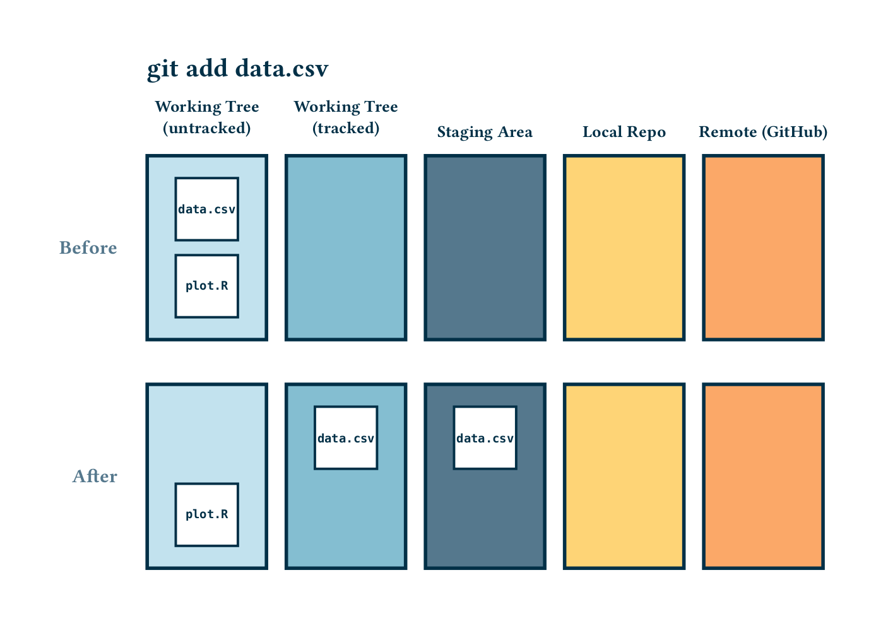
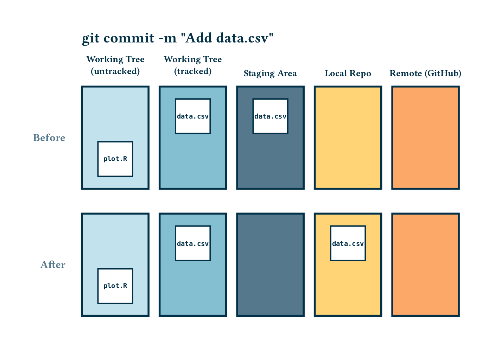
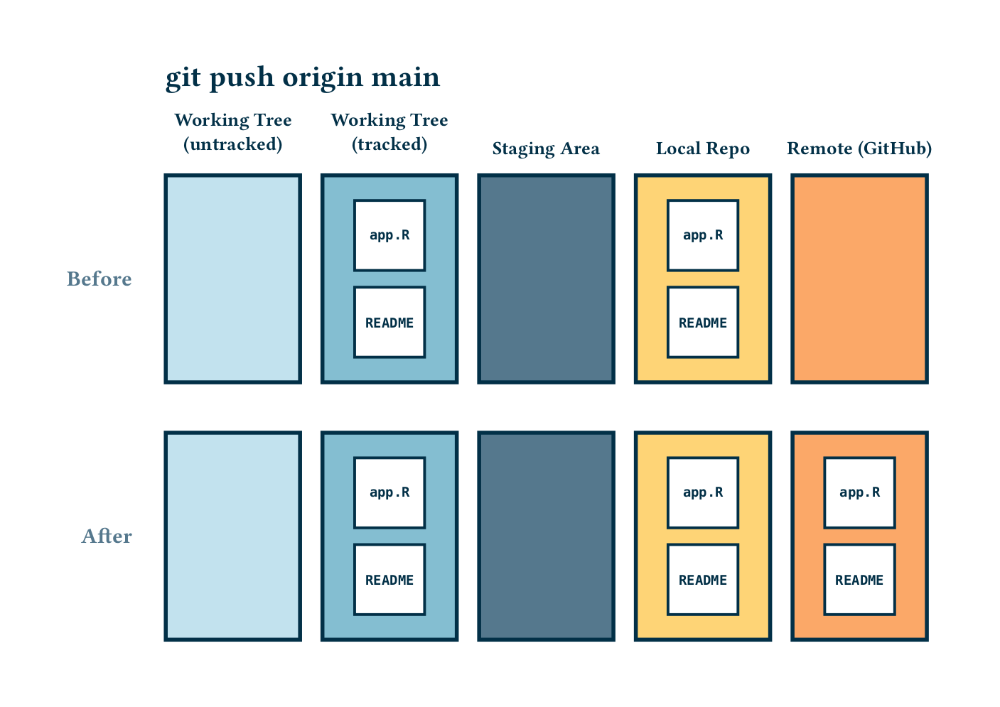
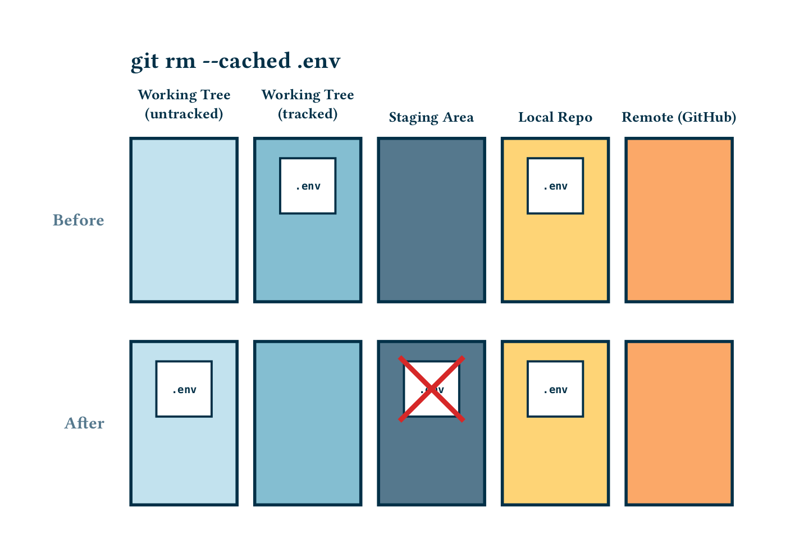
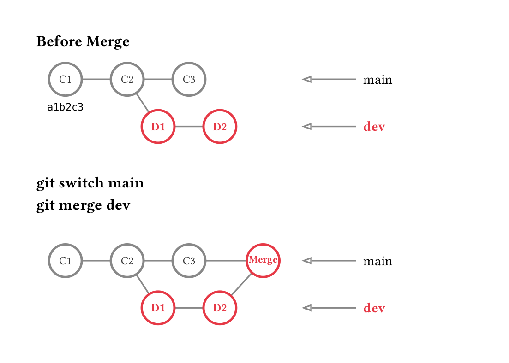

# Before you start

Check these before the session, because they are slow to fix once it has started:

* Git 2.28 or newer: run `git --version`.
* R with the shiny package: run `Rscript -e 'library(shiny)'`. If this fails, run `install.packages("shiny")` in R.
* A GitHub account that can push over HTTPS. GitHub does not accept your account password here, so you need a [personal access token](https://docs.github.com/en/authentication/keeping-your-account-and-data-secure/managing-your-personal-access-tokens) or a signed-in credential helper (Git for Windows includes one).

Replace `USERNAME` with your GitHub username wherever it appears below.

# Setup, Status & Ignore
### Initialize local repository and create `app.R`
1. Create a folder and initialize Git.
```bash
# 1. Create a project directory and enter it
mkdir shiny-git-demo
cd shiny-git-demo

# 2. Initialize Git tracking inside this folder, with main as the first branch
git init -b main

# 3. Set your identity (only once per machine; skip if git config user.name already prints your name)
git config --global user.name "Your Name"
git config --global user.email "your.email@example.com"

# 4. Check workspace status (should show: No commits yet, nothing to commit)
git status
```
2. Create a minimal `app.R`
Open a terminal text editor such as nano:
```bash
nano app.R
```
Paste the following barebones Shiny application code into nano:
```R
library(shiny)

ui <- fluidPage(
  titlePanel("Old Faithful Eruption Explorer"),
  sidebarLayout(
    sidebarPanel(
      sliderInput(
        inputId = "bins",
        label = "Number of Bins:",
        min = 5,
        max = 50,
        value = 20
      )
    ),
    mainPanel(
      plotOutput(outputId = "distPlot")
    )
  )
)

server <- function(input, output) {
  output$distPlot <- renderPlot({
    x <- faithful$waiting
    bins <- seq(min(x), max(x), length.out = input$bins + 1)

    hist(
      x,
      breaks = bins,
      col = "steelblue",
      border = "white",
      xlab = "Waiting time to next eruption (mins)",
      main = "Histogram of Waiting Times"
    )
  })
}

shinyApp(ui = ui, server = server)
```

Save and exit nano:
* Press Ctrl + O, then press Enter to save.
* Press Ctrl + X to exit.

3. Run the app to check that it works. Press Ctrl + C in the terminal to stop it. (In RStudio you can click **Run App** instead.)
```bash
Rscript -e 'shiny::runApp(launch.browser = TRUE)'
```

### Stage and commit

```bash
# Check status to see untracked app.R
git status

# Stage app.R
git add app.R

# Create initial commit
git commit -m "Initial commit: Barebone Shiny Old Faithful app"

# View commit history
git log --oneline
```

The diagrams below show what these commands do. They use example files, but your `app.R` follows the same path.





### Connect to remote and push as a branch

Create your own empty repository on GitHub, following [Creating a new repository on GitHub](https://github.com/admash/NPIGitLearn/wiki/Git-Basics#creating-a-new-repository-on-github). Name it `shiny-git-demo`.

**NB!** Leave it empty: do not add a README, `.gitignore` or licence. If GitHub creates a first commit for you, it will not share any history with your local repository.

```bash
git remote add origin https://github.com/USERNAME/shiny-git-demo.git

# Verify remote configuration
git remote -v

# Push main and configure tracking with -u
git push -u origin main
```



Create a feature branch
```bash
git switch -c feature/shiny-app

# Confirm active branch (marked with an asterisk)
git branch
```
Push the branch to GitHub
```bash
# Push branch and configure tracking with -u
git push -u origin feature/shiny-app
```
Verify on GitHub: open your repository and locate your new branch under the branch dropdown.

### Untrack files and set up `.gitignore`

*"Accidentally"* track a temporary file
```bash
# Create dummy files
touch .env .Rhistory

# Check status
git status

# Accidentally stage and commit .env
git add .env
git commit -m "Add environment configuration"
```
Remove .env from tracking without deleting it from your local filesystem:
```bash
git rm --cached .env

# Verify: .env is marked for deletion in staging, but still exists on disk
git status
```

The crossed-out copy is the staged deletion. `.env` stays in the Local Repo until your next commit.



Add some exceptions to .gitignore, for example using nano:
```bash
nano .gitignore
```
Add the following lines in the editor:
```
.Rhistory
.RData
.Ruserdata
.Rproj.user/
.env
```
Save and exit.

Commit and push the fix:
```bash
git add .gitignore
git commit -m "Untrack .env and configure .gitignore"
git push
```

**NB!** This only stops tracking `.env` from now on. The file is still in the history, including on GitHub, in the "Add environment configuration" commit. Your `.env` is empty, so that is harmless here, but a real password or API key pushed this way has leaked and must be replaced.

# Making Changes, Checking Diff & Discarding
## Code Change: Add User Controls

In app.R, update the UI and Server to allow selecting bar colors:
```bash
nano app.R
```
```R
# In UI (inside sidebarPanel): add a comma after sliderInput(...), then add selectInput:
      sliderInput(
        inputId = "bins",
        label = "Number of Bins:",
        min = 5,
        max = 50,
        value = 20
      ),
      selectInput(
        inputId = "bar_col",
        label = "Bar Color:",
        choices = c("Steel Blue" = "steelblue",
                    "Forest Green" = "forestgreen",
                    "Coral" = "coral")
      )

# In Server (inside renderPlot): replace col = "steelblue" with input$bar_col:
    hist(
      x,
      breaks = bins,
      col = input$bar_col,
      border = "white",
      xlab = "Waiting time to next eruption (mins)",
      main = "Histogram of Waiting Times"
    )
```

1. Inspect unstaged changes
```bash
git diff
```

2. Stage changes and check staged diff
```bash
git add app.R
git diff --staged
```

3. Practice unstaging without losing code ([Git Basics: Unstage Changes](https://github.com/admash/NPIGitLearn/wiki/Git-Basics#6-unstage-changes))
```bash
git restore --staged app.R
git status
```

4. Re-stage, commit and push
```bash
git add app.R
git commit -m "Add color picker input to sidebar"
git push
```

5. Practice discarding broken working changes ([Git Basics: Discard Local Working Changes](https://github.com/admash/NPIGitLearn/wiki/Git-Basics#11-discard-local-working-changes))

Intentionally introduce a syntax error in app.R (e.g., remove a closing parenthesis):
```bash
nano app.R
```
Run the app to see the error, then look at your edit and discard it:
```bash
Rscript -e 'shiny::runApp(launch.browser = TRUE)'
git diff
git restore app.R
git status
```
**NB!** `git restore <file>` permanently deletes your uncommitted changes to that file. Git cannot get them back.

## Bring your work into main

Your commits so far are only on `feature/shiny-app`. Merge them into `main`, so that the next section starts from your latest code:
```bash
git switch main
git merge feature/shiny-app
git push
```

# Branching & Merging
Branch 1: feature-stats

```bash
# Start from main
git switch main

# Create and switch to feature-stats
git switch -c feature-stats
```

Update app.R to add a summary table:
```bash
nano app.R
```
```R
# In UI, change mainPanel to:
    mainPanel(
      plotOutput(outputId = "distPlot"),
      tableOutput("statsTable")
    )

# In Server, add this inside server <- function(input, output) { ... }, after the end of renderPlot:
  output$statsTable <- renderTable({
    data.frame(
      Metric = c("Mean Waiting", "Median Waiting", "Sample Size"),
      Value = c(mean(faithful$waiting), median(faithful$waiting), nrow(faithful))
    )
  })
```

```bash
git add app.R
git commit -m "Add summary stats table beneath plot"
```

Branch 2: feature-help-text (Creates a Merge Conflict)
```bash
# Switch back to main
git switch main

# Create a parallel branch
git switch -c feature-help-text
```
Update the mainPanel layout in app.R on this branch:
```bash
nano app.R
```
```R
# In UI, change mainPanel to:
    mainPanel(
      plotOutput(outputId = "distPlot"),
      helpText("Data collected from Yellowstone National Park.")
    )
```

```bash
git add app.R
git commit -m "Add explanatory help text under plot"
```

Merge & Resolve Conflict

After the first merge below, `main` and `feature-help-text` have both moved on from where they split, like `main` and `dev` in this diagram. The second merge has to combine them.



```bash
git switch main
git merge feature-stats  # Fast-forward: main has not moved since feature-stats was created

git merge feature-help-text  # Triggers a MERGE CONFLICT in app.R
```
Git will alert you to a conflict in app.R. See which files are affected, then open the file:
```bash
git status
nano app.R
```
The conflict will look like this. The `plotOutput` line is above the markers because it is the same on both branches:
```
      plotOutput(outputId = "distPlot"),
<<<<<<< HEAD
      tableOutput("statsTable")
=======
      helpText("Data collected from Yellowstone National Park.")
>>>>>>> feature-help-text
```

Resolve the conflict by keeping both additions:
* Delete the three marker lines (`<<<<<<<`, `=======` and `>>>>>>>`).
* Add a comma after `tableOutput("statsTable")`.

The result should look like this:
```
      plotOutput(outputId = "distPlot"),
      tableOutput("statsTable"),
      helpText("Data collected from Yellowstone National Park.")
```

Save and exit nano. If you want to give up and go back to how things were before the merge, run `git merge --abort`.

Check that the app still runs, then finalize the merge:
```bash
Rscript -e 'shiny::runApp(launch.browser = TRUE)'
git add app.R
git commit -m "Resolve merge conflict between stats table and help text"
```

See the branches and the merge in the history, then push the result:
```bash
git log --graph --oneline --all
git push
```

Clean up the merged branches:
```bash
# Delete the local feature branches
git branch -d feature-stats feature-help-text
```

Verify on GitHub: open your repository on the `main` branch. `app.R` should include the color picker, the stats table and the help text.